# 工作看板 · 使用指南

> 适用版本：v0.6  
> 这是一份**给人看的**说明：只讲"在哪、怎么点、为什么这样设计"，不讲代码实现。  
> 全文配了实操截图，跟着图点一遍就会了。

---

## 目录

1. [安装与第一次打开](#1-安装与第一次打开)
2. [界面总览](#2-界面总览)
3. [项目与数据](#3-项目与数据)
4. [看板](#4-看板)
5. [甘特图](#5-甘特图)
6. [白板](#6-白板)
7. [文档](#7-文档)
8. [浮动浏览器](#8-浮动浏览器)
9. [给 AI 的指令](#9-给-ai-的指令)
10. [AI 后端怎么装（重要）](#10-ai-后端怎么装重要)
11. [导出](#11-导出)
12. [快捷键速查](#12-快捷键速查)
13. [常见问题](#13-常见问题)

---

## 1. 安装与第一次打开

### 下载

到 [Releases](https://github.com/wallenwang/mix_board/releases) 下载 `kanban-desk_v0.6_win64.exe`，放到任意文件夹双击即可，**不需要安装**。  
想放到桌面就右键「发送到 → 桌面快捷方式」。

### 自带的演示项目

**桌面版第一次打开、以及浏览器预览里**，侧栏都有一个「山茶间 · 品牌全案」演示项目。  
任务树拆到 **5 层**（T1 → T1.1 → T1.1.1 → …），共 31 个任务；  
白板上按层级从左往右分列，PDF / 图片 / 便签 / 文档统一排在**最右一列**；  
同一份资料被多个任务引用，强依据 / 参考 / 弱参考三档都挂好了。  
直接点白板工具栏的「整理」，就能看到这套排布规则。  
也可以拿它试「给 AI 的指令」，看生成的内容是否符合预期。

> 只建一次：删掉之后不会再自动回来。  
> 旧版的「山茶间 · 品牌视觉体系」会在打开时自动清掉，不会两个演示项目并排站着。

### 两个可能遇到的提示

| 现象                  | 原因                | 怎么办                                                                                            |
| ------------------- | ----------------- | ---------------------------------------------------------------------------------------------- |
| 提示「Windows 已保护你的电脑」 | 程序未做代码签名（签名证书要花钱） | 点「更多信息」→「仍要运行」                                                                                 |
| 双击没反应 / 白窗口         | 系统缺 WebView2 运行时  | 装 [WebView2 Runtime](https://developer.microsoft.com/microsoft-edge/webview2/)（Win11 自带，一般不用管） |

### 启动过程

双击后会先出现一个「工作看板 + 加载条」的画面，这是正常的设计：  
程序在背后把界面（看板、白板、文档编辑器）全部准备好再放你进来，  
所以界面一出现**就能直接操作**，不会出现"窗口出来了但点不动"。

打开速度取决于你上次退出时打开了几栏、文档有多大，通常 1 秒内。

---

## 2. 界面总览

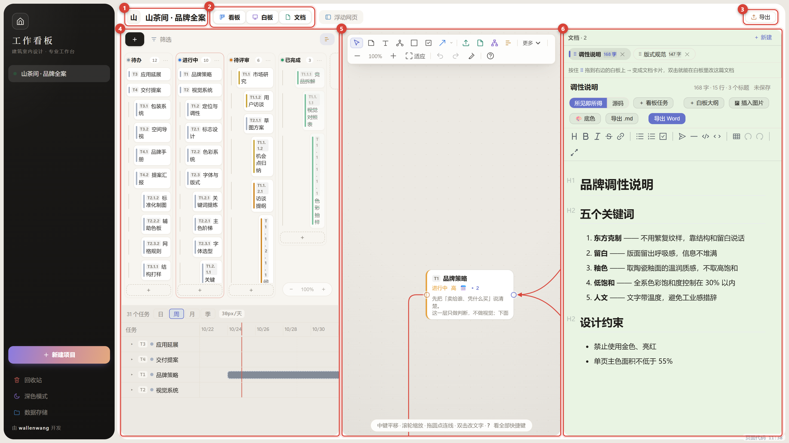

整个软件就三块：

1. **项目名**：左上角，点旁边的小箭头可以改名；
2. **顶部三个开关（看板 / 白板 / 文档）**：决定主工作区显示什么；
3. **主工作区（1~3 栏）**：看板、白板、文档，可以任意组合并排。

### 顶部三个开关不是单选

**「看板 / 白板 / 文档」可以同时点亮**，这才是它的用法：

- 勾 1 个 → 全屏显示这一栏
- 勾 2 个 → 左右分屏
- 勾 3 个 → 三栏并排

三栏之间的竖线可以**左右拖动**调宽度，**双击**则均分。  
侧栏右边那条线同样可拖，用来调项目列表宽度。

### 窗口窄了会自动变

窗口不够宽时（比如贴靠半屏），程序会自动切成"只显示一栏"，  
上方开关变成切换器，右下角会有提示条。把窗口拉宽会自动恢复分屏。

> 为什么这样设计：三栏各 260px 谁都看不清，不如让你专心用一栏。

---

## 3. 项目与数据

### 新建 / 切换项目

左下角「＋ 新建项目」，起个名字、选个图标即可。  
点左侧项目名切换，**每个项目的数据完全独立**。

### 数据存在哪

默认在这个文件夹（可以在侧栏底部「数据存储」里点开）：

```
%APPDATA%\com.kanban.desk\
├─ 项目列表.db                项目清单、主题、窗口尺寸等偏好
├─ 毕设/                       ← 一个项目 = 一个文件夹
│  ├─ 看板与白板.db            任务、列、白板节点与连线
│  ├─ 附件/                    你上传的原始文件（保留原文件名）
│  └─ 文档/                    文档正文，是真正的 .md 文件
└─ 课程设计/
```

**文档是真实文件**：用 Typora、VS Code、记事本都能直接打开 `文档/xxx.md`。

### 换位置 / 备份

- 侧栏底部「数据存储」→ 换一个文件夹 → 会**整体迁移**过去，旧位置保留不删（确认没问题再自己删）。
- **每天自动备份一份**：每次启动的第一次，软件会在后台把各个库拍一份快照存到数据目录下的 `备份/<日期>/`，留最近 7 天，更早的自动清掉。这一步是**后端自己做的，不看界面有没有加载成功**，所以不会弹提示，想确认就打开 `备份/` 看当天有没有文件夹。
- 备份只含**库**（任务、白板节点、连线、三档依据、文档索引），不含附件原件和 .md 正文——附件通常几百 MB 起，天天全拷不现实。要完整迁移仍然是把**整个目录拷走**。
- 想手动再备一份：把整个数据目录复制到 U 盘 / 网盘就行。

### 自动保存

没有「保存」按钮。停手约 1 秒就会写盘，关窗口前也会落盘。  
右上角会显示「保存中… / 已保存」。

---

## 4. 看板

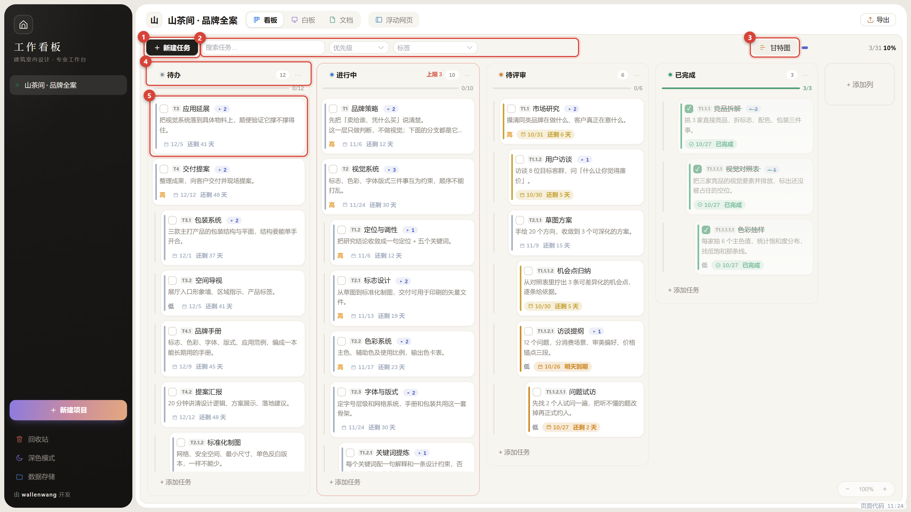

看板就是最经典的「待办 → 进行中 → 待评审」三列拖卡片。图上标的几处：

- **① ＋新建任务**：建一张卡片，选放到哪一列；也可以点列底部的「＋」。
- **② 搜索 / 筛选**：按标题、说明实时过滤；按优先级、标签筛，有条件时按钮上会有小圆点。
- **③ 甘特图开关**：收起 / 展开下方的甘特图。
- **④ 列头**：列名 + 数字（任务数 / 进度）；拖卡片到别的列，状态就变了。
- **⑤ 任务卡**：彩色小条是优先级，日期越接近越暖（黄 → 橙 → 红），勾选框打勾即完成（卡片变绿、自动排到列尾）。

### 基本操作

- **拖动**：卡片可在列内排序，也可拖到别的列。
- **改任务**：看板上点卡片（白板上双击卡片、或点铅笔按钮）打开同一张编辑卡。  
  顶部灰色块是这条任务的**结构信息**（编号、所属任务、下级、前置 / 后续、依据材料、交付格式），只读；下面是可编辑的标题、任务说明、优先级、标签、起止日期、进度。
- **快速编辑**（白板）：双击卡片上的说明文字，直接在卡片里改标题和说明，点外面即保存。
- **卡片上的按钮**（悬停出现）：＋子 / ＋同 / 📎 挂资料 / 📝 写成文档 / 铅笔编辑 / AI 指令。
- **删除**：删掉的任务进「回收站」（侧栏底部），可以恢复。
- **缩放**：Ctrl + 滚轮缩放看板，右下角有 −/＋ 按钮与百分比，点百分比回到 100%。  
  普通滚轮仍是横向滚动，两者互不干扰。缩放比例会记住，下次打开还是这个倍率。

> 栏被拖窄时，搜索筛选会自动收进一个「筛选」气泡，避免工具条撑成四行。

---

## 5. 甘特图

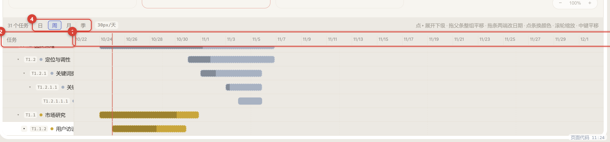

看板下方那条就是甘特图，默认占下方约 1/3 高度。

### 三条容易踩坑的交互

| 操作           | 结果                  | 说明                                 |
| ------------ | ------------------- | ---------------------------------- |
| **滚轮**       | 横向**缩放时间轴**（不是上下滚动） | 鼠标指着哪一天就以哪天为锚点缩放，天数格子从 3px 到 140px |
| **按住中键拖动**   | 平移画布                | 左键是选中/拖条，所以平移给了中键                  |
| **拖动条的左右两端** | 改开始 / 截止日期          | 拖动中间是选中，不改日期                       |

### 调整高度

看板和甘特之间那条细缝可以**上下拖**，双击恢复 1/3。

### 颜色

- **默认按紧迫度自动上色**：逾期红、3 天内橙、7 天内黄、其余灰，完成变绿。
- **想手动指定**：点一下甘特条 → 弹出 6 个色块（第一个是「紧急·火烧眉毛」的红）→ 选完立即生效。
- 想恢复自动配色：同一个面板里点「恢复自动」。

> 手动颜色会一直保留，不会因为日期变化被覆盖。

### 没有任务时

如果一个任务都没有，甘特区不占位置（不显示空框）。

---

## 6. 白板

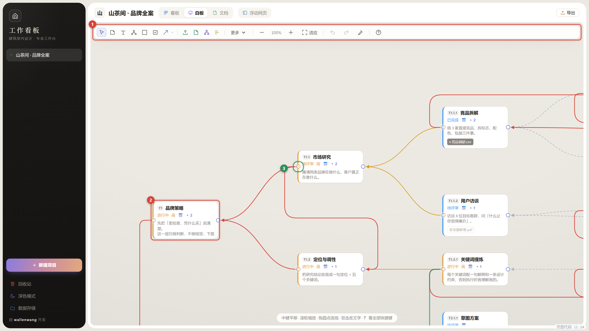

白板是这块软件里最"自由"的部分——它同时也是**思维导图**和**白板+卡片**的结合体。  
图上标的几处：**① 工具条**（建便签 / 文字 / 导图 / 分组框 / 图片 / 文档卡）、**② 任务卡**（跟看板是同一份数据）、**③ 便签**（一句话想法）、**④ 端口**（每个节点左边一个输出点、右边一个输入点，线的进出都走这两个点）。

### 七种节点

| 节点   | 用途          | 怎么建                      |
| ---- | ----------- | ------------------------ |
| 便签   | 一句话想法、待整理   | 工具栏 📝 或双击空白             |
| 文字   | 标题、分区说明     | 工具栏 T                    |
| 思维导图 | 层级化拆分       | 工具栏 🧠，Tab / Enter 快速加节点 |
| 分组框  | 把一片区域圈起来做分区 | 工具栏 ▭，拖出范围               |
| 图片   | 参考资料、效果图    | 工具栏 🖼 上传，或直接拖文件进来       |
| 文档卡  | 指向某篇文档的快捷入口 | 工具栏 📄                   |
| 甘特卡  | 把甘特图搬到白板上看  | 「更多」菜单                   |

**这七种都有左右两个端口**，都能被连线、都能当依据、也都能是产物——不因为它是图片或分组框就低一等。

### 连线就是层级：左边永远是输出，右边永远是输入

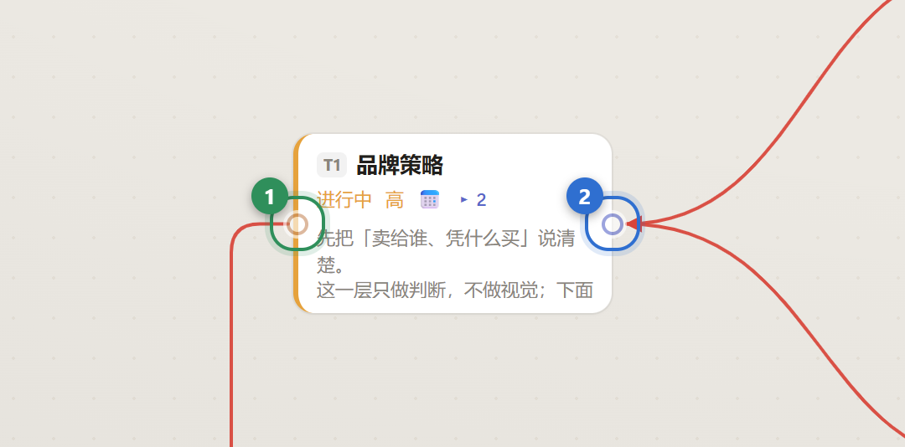

全板统一：**左边小圆点 = 输出，右边小圆点 = 输入**。  
子级的产出从子卡的**左端口**出去，流进父级的**右端口**——所有节点都长着这两个小圆点（任务卡、便签、文字、导图、图片、文档卡、甘特卡、分组框都有），任何东西都能当依据、都能是产物。

- 拖**左侧圆点**到另一张卡 → 对方接住这张卡的产出，**成为它的上级**。
- 拖**右侧圆点**到另一张卡 → 对方的产出送进来，**成为它的下级**。
- 两头都能起线，方向在建边时自动摆正，所以从父往子拖、还是从子往父拖，画出来都是同一条「输出 → 输入」的线。
- **一条线的形状只由它自己的两个端点决定**：拖任何一张卡片，只有跟它相连的线会动，别的线一根都不动。
- **线永远「左边出去、右边进来」**：父子上下叠在一起时，线会从子卡左侧绕出去、走两卡中间的空隙、再从父卡右侧插进去。
- **线上不画箭头**：方向已经由两个端口约定死了，箭头只是多余的黑点。但导出的 PNG / PDF 里端口控件会被去掉，所以**导出时会自动在线的两头各补一个小圆点**，成品图照样看得出谁支撑谁。
- 导图的缩进、Tab 建下级、拖动父节点带动子节点，全都依赖这条"父子关系"。

### 连线的四档关系

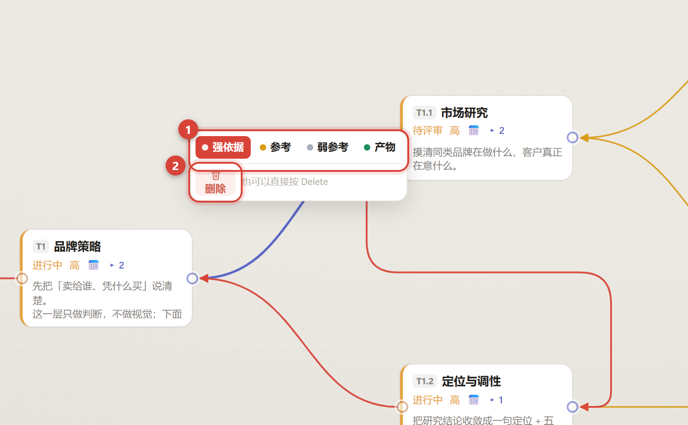

**点一下连线**，弹出上面这个小菜单，只有**一排四档**，点一下就换：

| 档位  | 颜色    | 含义            | AI 会读吗       |
| --- | ----- | ------------- | ------------ |
| 强依据 | 🔴 红  | 不得违反，冲突时以它为准  | **会，进参考材料**  |
| 参考  | 🟡 黄  | 可用来补充，不构成强制要求 | **会，进参考材料**  |
| 弱参考 | ⚪ 灰虚线 | 仅供理解语境，不作论据   | 会，但只作背景      |
| 产物  | 🟢 绿  | 东西是从这儿产出的     | **不会，只算交付物** |

- **颜色就是档位**：扫一眼就知道哪些是硬约束。
- 点完线也可以直接按 `Delete` 删掉，不必点菜单里的「删除」。
- **一个子可以有几个上级，这是允许的**：同一个子任务的成果被几个上级同时用到，就挂两条父线，不用复制卡片。每个上级运行的时候只看自己的直系子集，另一个上级跟它没关系、互不干扰。交给 AI 的指令会把**全部上级**都列出来；编号只按最早建的那条父线算，所以卡片的号是稳定的。
- **关系不能绕成环**，这是硬规则：
  - 依据 / 分解只能**从下级指向上级**，差多少级都行（孙子给爷爷当依据完全没问题）；
  - **上级不能当自己直系后代的依据**——那等于父子互为依据，编号、层级展开、交给 AI 的上下文都会当场绕不出来；
  - **旁系随便连**：T1.1 给 T2.1.1 当依据是允许的，它俩不在同一条直系链上；
  - 真连成环时会直接弹提示拦住，这条线根本不会建出来（不是建完再报错）。

### 分组框：把一片区域圈起来

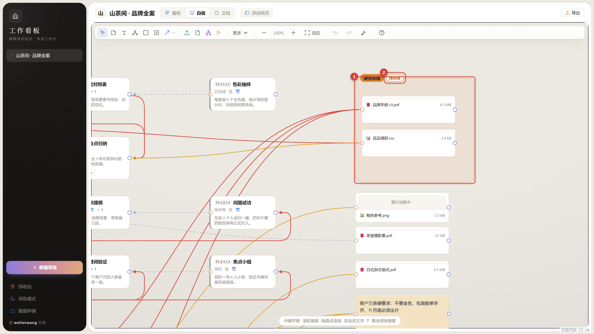

三种建法，看当时顺手：

| 建法        | 操作                                                        |
| --------- | --------------------------------------------------------- |
| 拖出一个范围    | 点工具栏的分组框按钮，在画布上**按住左键拉一个矩形**，松开就成框                        |
| 把选中的卡片装进去 | 先 Ctrl 点选（或框选）几张卡，再点**同一个**分组框按钮，它们自动被装进一个新框；快捷键 `Ctrl+G` |
| 点一下放一个    | 点工具栏按钮后在空白处**单击**，得到一个默认大小的框，可以马上改标题                      |

它**不需要"把节点拖进组"**——整张卡都落在框内，就自动算作这个分区（露出一半不算）：

- 拖动框 → 框里所有节点一起移动；
- 把节点拖进框 → 自动加入；拖出去 → 自动离开；
- 框套框也可以，外层框动的时候内层整组跟着走。

#### 名称右边那个标签：这批材料「有多硬」

框的名称右侧紧跟着一个标签，点一下就弹出**和连线一模一样的四档**（强依据 / 参考 / 弱参考 / 产物）。它有两个作用：

1. **一眼分辨**：框的颜色会跟着档位走，扫一眼就知道哪一块是硬材料；
2. **拖线自动带档**：从框里拖一份资料到任务，那条依据会按框的强度自动定档，不用再点一次改档。具体到某个任务仍可随时改。

把一条线的状态改成「产物」时，如果那头连着分组框，这个框会被**自动标成产物组**（框头挂绿标），不用再单独点工具条上的 ◈；改回别的档位时，标会自动摘掉。

标签是常显的，不选中也能看见——所以新框天生带一个「参考」，不需要先去设置什么。

> 为什么这样设计：开会画白板时，你不会想让"分组"变成一堆需要维护的勾选操作，用空间位置表达归属最直观。

### 从端口拖到空白处 = 直接建节点

拖出一个连线但松手在空白处，会弹出节点类型菜单（便签 / 文字 / 导图 / 分组框 / **图片·资料** / 文档 / 甘特），选完自动把新节点连上——这是最快的一张"脑图扩展"方式。

> 选「图片 / 资料」会先弹出文件选择框，选好文件后自动建成图片节点并连回原节点，不用先上传再手动拖进来。

### 图片与文档的联动

- 右键白板上的图片 → **发送到文档**：这张图会插到文档栏当前光标处。
- 右键 → **预览** / **在文件夹中显示**。
- 文档卡右键 → **去文档**：左侧文档栏自动切到那一篇。

### 材料的审核标记：哪些能交给 AI，哪些不能

资料卡、图片、文档卡的工具条里有一个 **「审」** 按钮，点一下走一格：

| 状态     | 卡片左上角      | 对 AI 的影响          |
| ------ | ---------- | ----------------- |
| 未审（默认） | 不显示        | 照常进指令             |
| 已通过    | 绿标「✓ 已通过」  | 进指令，并注明「已人工审核确认」  |
| 打回     | 红标「✗ 打回」   | **完全不进指令**        |

为什么要标这一下：AI 分不清哪份是你刚拖进来还没看的、哪份是你逐条核对过的，它一律照用。人标一下最省事——核对过的材料 AI 更敢直接引用；被你否掉的废稿不会再被当成依据，错误也就不会顺着上下级往上传。

点绿标直接变红标、点红标回到未审，不用进菜单。

### 删除与回收站

删掉的卡片**不会立刻消失**：先进回收站（侧栏底部「回收站」），30 天内随时「放回白板」；超期、或你手动点「删除」，才真正抹掉（资料的文件本体一起删）。

- 保留天数在回收站里改：**30 天 / 60 天 / 永不**。
- 任务删除同理，两类东西都在同一个回收站面板里。
- 上传资料挂到节点下：挂到**任务**上 = 依据（资料 → 任务），不是把资料变成任务的上级；挂到**便签 / 导图**下才是它的下级。

### 导出白板

顶部「更多」→ 导出 PNG（整块画布）或单页 PDF。  
导出的图会按内容范围裁切，不会带一大片空白。

---

## 7. 文档

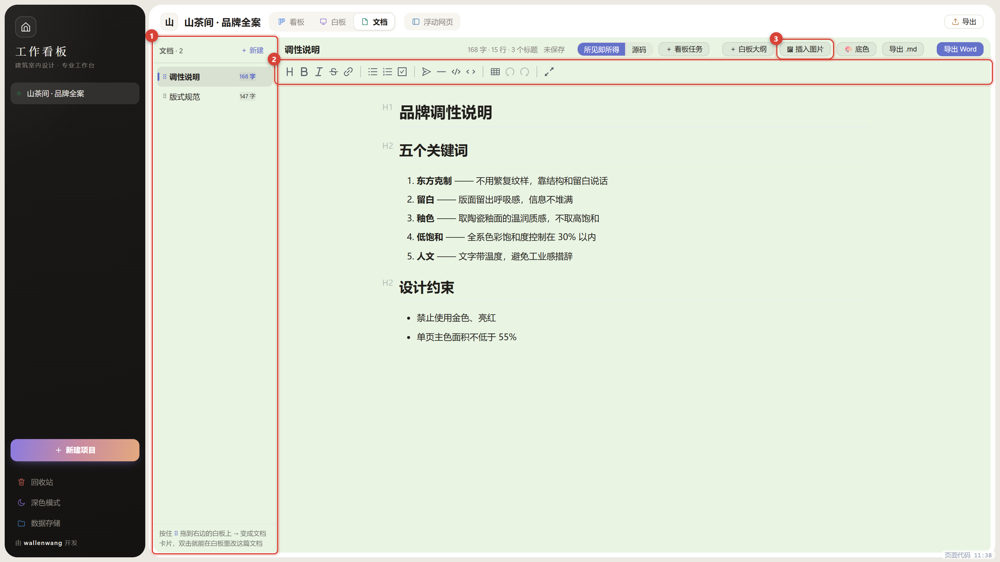

顶部开关点「文档」打开。**① 左侧是文档列表**，**② 顶部是格式工具栏**（标题、加粗、列表、待办、表格、代码块、分割线），**③ 右侧大区域是正文**，默认**所见即所得**（像 Word 一样直接写，不出现 `#`、`**` 这些语法）。

### 写正文

- 快捷键：`Ctrl+B` 加粗、`Ctrl+I` 斜体、`Ctrl+K` 链接、`Ctrl+S` 立即保存。
- 想看着 Markdown 原文写：右上可以切到「源码」模式（左侧源码 + 右侧预览）。

### 底色

工具栏「🎨 底色」可以换正文背景：护眼绿（默认）/ 纸白 / 米黄 / 淡蓝 / 淡紫 / 自定义取色。  
文字颜色会跟着底色自动取深色或浅色，不用手动调。

### 插图

两种来源：

1. 文档栏「🖼 插入图片」→ 从本机选 / 从白板图片里选；
2. 白板上右键图片 → 发送到文档。

图片会**内嵌进 `.md` 文件**（base64）。好处是把这一个 `.md` 发给别人、换电脑打开，图片都还在，不会变成裂图。

> 为什么大文档也很快：编辑器内部把内嵌图片换成了内存短链来显示，存盘时再换回原格式。所以你看到的效果是"图正常显示、文件格式没变"，但打开一个几 MB 的文档也不会卡住。

字数统计会**自动排除图片数据**，不会出现"30 万字"这种吓人的数字。

### 从别处搬内容进来

- 「＋ 看板任务」：把当前看板的任务连同父子层级一起贴成大纲。
- 「＋ 白板大纲」：把白板上的思维导图变成缩进列表。

### 导出

- **Markdown**：`.md` 原文件（含图片）。
- **Word**：`.docx`，中文排版已调好。  
  ⚠️ 目前 **Word 不含图片**（图片位置会留文字说明），需要图请用 Markdown 或 PDF 路径。

---

## 8. 浮动浏览器

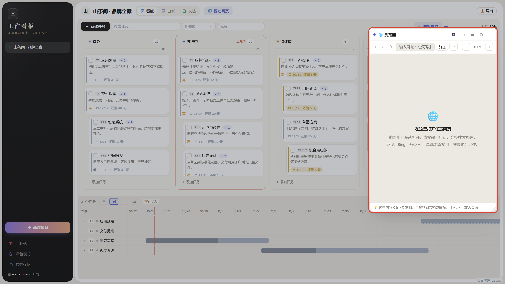

顶部「浮动网页」可以打开一个可拖动、可缩放的网页窗口（图上红框），盖在看板/白板上面查资料、用 AI 工具。

- 地址栏输网址就打开；输一句话（带空格）会走搜索引擎。
- **中文域名可以直接输**：`豆包.com` 会直接打开，不会被当成搜索词。
- 支持前进 / 后退 / 刷新 / 缩放；宽度有手机、平板、宽屏三档。
- 拖标题栏移动，拖右下角改大小，双击标题栏最大化；位置和尺寸会被记住。
- 关掉后 20 秒会真正释放内存，下次打开重新加载。

### 它是个真浏览器，不是"嵌网页"

内容区用的是系统内核的独立网页视图（不是 iframe），所以：

- 豆包、Bing 结果页这类**禁止被嵌入**的站点也能正常打开；
- 在搜索结果里**点链接会直接在当前浮动网页里跳转**（不会点了没反应）；
- **登录状态能记住**，可以一直挂着用 AI 助手。

> 少数网站仍可能因自身策略拒绝在非浏览器环境运行；点标题栏的 `↗` 用系统浏览器打开即可。  
> 本软件不预置任何第三方网站入口，访问什么由你决定；使用时请遵守对应网站的服务条款。

---

## 9. 给 AI 的指令

这是这个软件和普通看板最不一样的地方：**你把项目摆清楚，它替你把话说给 AI。**

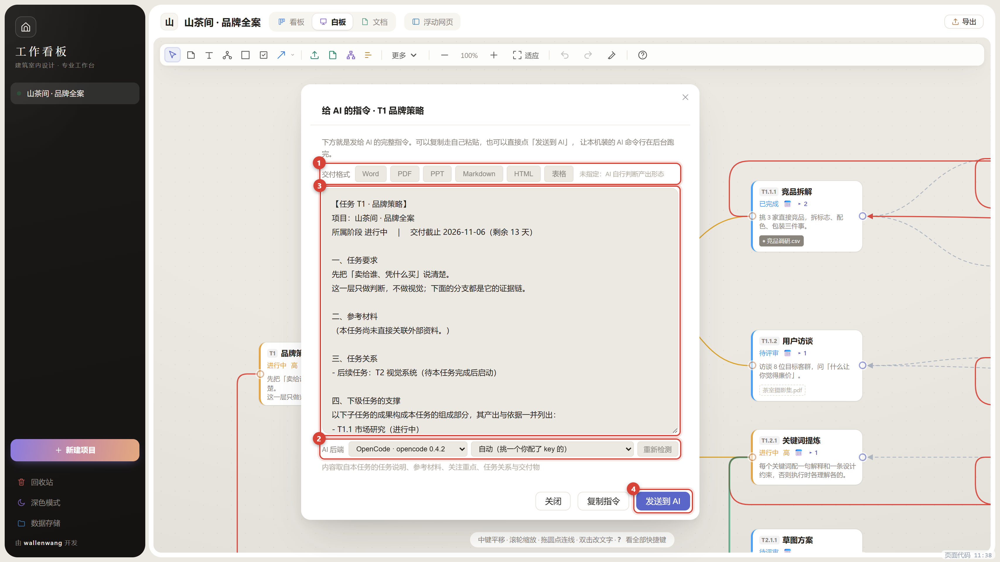

在任务卡上点 `AI`（白板的卡片工具条里、看板的卡片右下角都有），弹出一段现成的话。  
你可以点「复制指令」自己粘到任意 AI 对话框里，也可以直接&#x70B9;**「发送到 AI」**，让本机装的 AI 命令行在后台把活干完，产物自动收回来。

### 先填一次「角色卡」（一个项目填一次就够）

弹窗顶部有一行折叠的 **角色卡**，点开写两三句，比如：

> 你是品牌视觉设计总监，服务客户是「山茶间」中式茶饮；产出要能直接进教材当示例，风格克制、不用网络热词，中文标点用全角。

保存之后，**这个项目里每个任务的指令都会带上一段「【你的角色】」**，不用一个任务一个任务重复写。

软件不替你猜角色——从任务标题去判断你是室内设计师还是品牌策划，猜错比不填更糟（AI 会照着错误的专业口径写一整篇）。所以这里就是让你自己写一句：成本最低、效果最直接。换项目要另填一份。

### 发送到 AI

点之前先在下方的「AI 后端」里选一个本机装好的命令行（怎么装、怎么让它被检测到，见下一节），模型可留空用它默认的：

| 后端                      | 说明                                                      |
| ----------------------- | ------------------------------------------------------- |
| OpenCode                | **装了 OpenCode 桌面版就有了**，它自带 CLI（`opencode-cli.exe`），不用另装 |
| DeepSeek Harness        | `dsh`，已装的话直接可用                                          |
| Gemini / Claude / Codex | 需要本机装了对应的 CLI                                           |

点「发送到 AI」之后发生的事：

1. 在项目文件夹下建一个工作目录 `AI产出/<任务>/`，把指令写成 `brief.md`，把参考材料拷进 `refs/`，再准备一个空的 `out/`。
2. 通过 ACP 协议把指令交给命令行。**中文不会乱码**——指令是写成 UTF-8 文件的，命令行上只出现路径。
3. **点完就返回，不等它跑完。** 你可以立刻关掉这个面板，去点下一个任务的 AI。
4. 面板里实时显示 AI 的回复与过程日志，随时可以「中止」。
5. 跑完列出 `out/` 里收到的产物，&#x70B9;**「把产物打成组放到白板」**，就会在白板上出现一个**产物组**：框头挂一个绿色「产物」标，产物按上传资料的方式排在里面，并且自动拉一条**绿色产物线**连回任务（从产物组连到任务）。
6. 只想留其中几张？**按住产物名字直接拖到白板上**，落在哪就在哪生成一张资料卡，不连线、不成组，要挂给谁你自己拖。
7. 关掉面板再点同一个任务的 AI，会**直接接回这一轮**（没跑完就接着看进度，跑完了就显示「上次跑于 …」和产物列表），不用重跑；想重跑就再点一次「发送到 AI」。

想自己翻产物，点「打开工作目录」。

### 右下角的「AI」按钮：同时盯好几个任务

同时发四五个任务是常态，所以运行中的任务都收在**右下角那个圆形的「AI」按钮**里：

- **数字 = 正在跑的数量**，外圈会呼吸；全跑完后数字变成橘色，代表「有几条结果你还没看」。
- 点开是一张列表，每条一行：任务号 + 状态（准备中 / 跑着 3 分 12 秒 / 完成 · 2 份产物 / 出错）。
- **点一下某条就展开**：AI 的回复正文、产物清单、过程日志（折叠着）、以及「中止 / 看指令 / 放到白板 / 打开目录」四个动作。
- 任务跑完时，如果你没正看着它，右下角会弹一条提示，列表里那条标个「新」。
- 「清空已完成」只清列表，**产物文件和白板上的卡片都不动**。

> 一句话记住：**面板是"窗口"，不是"进程"**。关掉窗口 AI 照跑，关掉软件才会停。

> 一个提醒：AI 写文件偶尔会偷懒只回文字。这时软件会把回复存成 `AI 回复.md`，保证组里至少有一张能看的卡片。  
> 更详细的机制与实测记录见 `docs/AI接入说明.md`。

面板是**浮动的**：不加遮罩，标题栏可拖动，停在旁边时白板照常能缩放、平移、拖卡片。  
把它拖到右边，左边就是完整的操作区。点面板外面不会误关，用完点「关闭」。

### 这段话是怎么来的

没有一个字是模板，全部从你已有的东西里读出来：

| 读的东西                | 变成指令里的哪一段      |
| ------------------- | -------------- |
| 任务说明、所属阶段、交付截止      | 一、任务要求         |
| 挂在本任务上的资料及其约束层级     | 二、参考材料         |
| **你给每份资料标注的关注重点**   | 材料条目下的「关注重点：…」 |
| 白板上连到本任务的思维导图、便签、文字 | 四、白板关联内容       |
| 上级、上游、下游、下级任务       | 三、任务关系         |
| 产出物与交付格式            | 五、交付物          |
| 由材料情况生成的执行规则        | 六、输出要求         |

改完任务、资料层级或关注重点后，重新打开即为最新内容。指令中还有一段「七、信息缺口」，列出任务说明为空、未关联资料、未标注关注重点等情形。

**缺口不是让 AI 停下来追问**：那一段同时授权它「按已有材料做最合理的假设照常交付，凡是补出来的判断用『假设：……』标出来」。这样它不会因为少一张表就原地空转，你事后也能一眼看到它替你做主了哪些地方。

指令开头还有两段固定的规矩：**「【你的角色】」**（来自角色卡，没填就没有这段）和 **「【开工规矩】」**（不复述指令、先列执行计划再动手、交付物必须真写成文件）。这两段是为了治 AI 的两个老毛病——先客套一遍再干活、只回一段文字不写文件。

### 任务关系的四个词

| 词        | 含义                     | 怎么来的                  |
| -------- | ---------------------- | --------------------- |
| **所属任务** | 本任务是它的一部分，做完作为它的组成部分交付 | 父子连线（父 → 本），有几个上级就列几个 |
| **前置任务** | 必须等它完成，其结论可直接采用        | 先后连线（它 → 本）           |
| **后续任务** | 它在等本任务完成               | 先后连线（本 → 它）           |
| **下级任务** | 本任务拆出的子项，会带上它的说明与关注重点  | 父子连线（本 → 子）           |

「所属」和「前置」的区别：所属是**结构归属**（我是谁的一部分），前置是**时间顺序**（我得等谁）。  
同一个任务可以既属于 T2、又等 T1 做完，两者互不相干。

### 交付格式

弹窗上方有一排格式按钮：Word、PDF、PPT、Markdown、HTML、表格、**图表 SVG**。选定之后：

- 指令的「四、交付物」会写明交付格式；
- 「五、输出要求」会追加该格式的产出规则，例如选 PPT 会要求「每页一个标题，配 3 至 5 条要点」，选 Word 会要求「使用规范标题层级，不要用 Markdown 井号」；
- 再点一次已选中的按钮即取消指定。

**「图表 SVG」是给画图用的**：让 AI 直接写成 SVG 代码（流程图、结构图、配色示意图、数据分析图），落地就是 `out/xx.svg`，收回来能当图片卡看、能插进文档。这条路零成本——不用装任何画图模型，本机的命令行 AI 就会写。

格式跟随任务保存，换台机器打开也还在。

### 白板关联内容：思维导图和便签也会传进去

白板上连到本任务的思维导图、便签、文字节点，会作为「四、白板关联内容」一并写进指令。  
这些内容往往是最精炼的思路，比任务说明更接近真实想法。

资料（文件节点）不重复列——它们已经在「参考材料」里按约束层级分好组了。


### 关注重点：帮它找到重点

文件本身要一并拖给 AI——现在的模型能直接读 PDF、Word 和图片，不需要先把内容抄一遍。指令里列的清单就是告诉你该传哪几个。

关注重点写的是另一件事：**这份材料里，这个任务该重点看哪儿。**

材料动辄几十上百页，AI 全读完也不代表它抓得住重点。你写一句「第 12 页的颜色规范最关键；主色限墨绿，禁止高饱和红」，它就知道该往哪儿使劲。

点任务卡上的资料标签，弹出的小框里写：

> 主色限墨绿系（#2F4F3A 一带），禁止高饱和红；页边距不小于 18mm

这句话会原样出现在指令里。写过的标签前面会多一个小圆点。

小框里同时能改档位（必须遵守 / 可以参考 / 仅作背景）。**换档不会清掉已写的要点。**

没有写要点的资料，指令的最后会列出来提醒你：

> 六、这份任务还缺
> - 2 份材料还没说重点（竞品调研、行业报告）。文件传过去它会读，但不点出重点，它容易抓错地方
> - 任务上没挂产出物，AI 只能自己判断该交什么

这一段的目的不是挑剔，是让你知道这份指令哪里还漏风。

### 要点和任务说明的区别

| | 写在哪儿 | 回答什么 |
| --- | --- | --- |
| 任务说明 | 任务本身 | 我要做什么 |
| 资料要点 | 资料挂在任务上的那条关系 | 这份材料该重点看哪儿、什么不能违背 |

同一份资料挂在两个任务上，可以是两句不同的要点——因为它对这两个任务提的要求本来就可能不同。

---

## 10. AI 后端怎么装（重要）

「发送到 AI」**不依赖任何在线服务，也不自带模型**——它调用的是你电脑上已经装好的 AI 命令行工具（CLI）。所以想用这个功能，得先过下面四步：

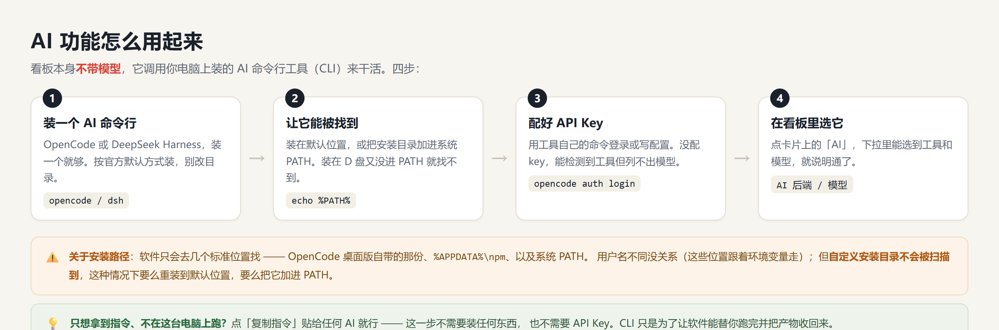

### 第一步：装一个 AI 命令行

任选其一（装一个就够，装多个也行）：

| 工具 | 怎么装 |
| --- | --- |
| **OpenCode** | 推荐。装 [OpenCode 桌面版](https://opencode.ai)就有了，它自带 CLI，不用额外操作 |
| **DeepSeek Harness** | 按官方说明装 `dsh` 命令行 |
| Gemini CLI / Claude Code / Codex CLI | 各自官方文档给出的安装方式 |

### 第二步：让它能被检测到（关键）

软件启动时会自动扫描这几个**标准位置**，找到哪个就用哪个：

| 位置 | 谁在这 |
| --- | --- |
| OpenCode 桌面版自带的目录（`%LOCALAPPDATA%\Programs\` 下） | 装桌面版自动就在 |
| `%APPDATA%\npm\`（npm 全局安装的命令都在这） | `dsh` 等 npm 装的 CLI |
| 系统 **PATH** 环境变量里能直接敲到的命令 | `gemini` / `claude` / `codex` 等 |

三条硬道理：

1. **按官方默认方式装，基本都能被找到。** 用户名不一样没关系——扫描跟着系统环境变量走，不写死路径。
2. **装到 D 盘、自定义目录，又没加进 PATH，就找不到。** 这种情况要么重装到默认位置，要么把安装目录加进系统 PATH（`此电脑右键 → 属性 → 高级系统设置 → 环境变量 → Path → 新建`，填工具所在的文件夹）。
3. 检测是**真跑一次 `--version`** 确认的，坏文件不会被误判。AI 弹窗的「AI 后端」下拉里看不到你装的工具时，点旁边的「重新检测」再扫一遍。

### 第三步：配好 API Key

命令行工具本身只是"跑腿的"，模型要靠各家的 API Key（或账号登录）：

- **OpenCode**：终端里敲 `opencode auth login`，按提示选服务商、粘 Key；
- **DeepSeek Harness**：按它的说明把 Key 写进配置或环境变量；
- 其他 CLI 同理，各自都有登录 / 配 Key 的命令。

**没配 Key 的工具即使被检测到，也拉不出模型列表、跑不了任务**——这不是看板软件的问题，是工具还没"通油"。

### 第四步：回来看板里选它

点任务卡上的「AI」→ 「AI 后端」下拉里选刚检测到的工具 → 「模型」可以留空（用它默认的）→ 点「发送到 AI」。

> **只想复制指令、不想在台式电脑上跑？** 点「复制指令」粘贴给任意 AI 网页版就行——这一步不需要装任何东西，也不需要 API Key。CLI 只是为了让软件能替你跑完并把产物收回来。

---

## 11. 导出

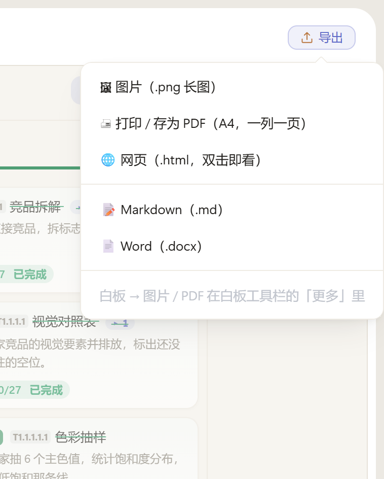

| 位置 | 菜单 | 可选格式 |
| --- | --- | --- |
| 看板 | 右上「导出」 | **PNG 长图、PDF（打印）、网页 HTML**、Markdown、Word |
| 白板 | 工具条「更多」 | PNG 图片、单页 PDF |
| 文档 | 文档栏工具栏 | Markdown、Word |

**导出的图和屏幕长得一样**：白板的弧线连线、端口圆点、便签配色与圆角，导出后不会变样。

- **PNG**：所有列横向排开的一整张长图，2 倍分辨率，投影和打印都不糊；
- **PDF**：弹出打印窗口，目标打印机选「另存为 PDF」。一列一页，文字能选中、能搜索；
- **HTML**：单个文件，双击用浏览器就能看，对方不需要装这个软件；
- **Word / Markdown**：结构一致（同一套排版规则），任务层级与导图缩进都会保留。

导出图里**不会**出现端口小圆点、选中框、悬浮工具条——那些是操作控件，不是内容。

看板导出的任务层级、白板导出的导图缩进都会保留。

---

## 12. 快捷键速查

### 白板（先点白板空白处获取焦点）

| 快捷键 | 作用 |
| --- | --- |
| `Tab` | 建下级 |
| `Enter` | 建同级 |
| `Delete` / `Backspace` | 删除（点选连线后按它 = 删线） |
| `F2` | 重命名 |
| `Ctrl+Z` / `Ctrl+Shift+Z` | 撤销 / 重做 |
| `Esc` | 取消选择 / 退出连线 |
| `空格+拖` / `中键拖` | 平移 |
| 滚轮 | 缩放 |

### 文档

| 快捷键 | 作用 |
| --- | --- |
| `Ctrl+B` / `Ctrl+I` / `Ctrl+K` | 加粗 / 斜体 / 链接 |
| `Ctrl+S` | 立即保存（平时会自动保存） |
| `Tab` | 源码模式下插入缩进 |

### 甘特图

| 操作 | 作用 |
| --- | --- |
| 滚轮 | 缩放时间轴 |
| 中键拖动 | 平移 |
| 拖条两端 | 改起止日期 |
| 点条 | 换颜色 |

### 通用

| 操作 | 作用 |
| --- | --- |
| 拖分栏竖线 | 调宽度 |
| 双击分栏竖线 | 均分 |
| 拖看板/甘特之间细缝 | 调甘特高度（双击回 1/3） |
| 双击侧栏分隔线 | 侧栏恢复默认宽度 |

---

## 13. 常见问题

**Q：双击没反应，或者窗口一片白？**  
A：缺 WebView2 运行时。Win11 一般自带；Win10 请装一下（链接见第 1 节）。

**Q：杀毒软件报毒 / Windows 提示不安全？**  
A：程序没有代码签名，属于未签名程序的常规提示。源码在仓库里，可以自己编译核对。

**Q：换电脑怎么搬数据？**  
A：把整个数据文件夹（第 3 节那个目录）拷过去，在新电脑的侧栏「数据存储」里指向这个文件夹即可。  
或者在新电脑上先打开一次，再用「数据存储 → 更换位置」指过去。

**Q：文档里的图片会不会丢？**  
A：不会。图片内嵌在 `.md` 里，单独把文件发给别人也能看到图。  
但注意：**Word 导出不含图片**。

**Q：白板上的字有时黑有时白？**  
A：按背景亮度自动选的（保证对比度）。浅色便签配深字，深色便签配白字，不需要手动调。

**Q：AI 后端下拉里是空的 / 没有我装的工具？**  
A：看第 10 节。要么没装 CLI，要么装在了非默认位置又没进 PATH；点「重新检测」再扫一遍。模型列表拉不出来 = API Key 没配。

**Q：为什么第一次打开大文档会等一下？**  
A：文档里如果嵌了很多图片，编辑器首次要建立图片缓存；之后切回来就很快了。

**Q：看板和白板是两份数据吗？**  
A：不是。看板任务和白板上的任务卡是**同一份数据**，改哪边都同步；白板上的位置是额外记录的。

**Q：浮动浏览器白屏？**  
A：该网站不允许被嵌入。点 `↗` 用系统浏览器打开。

**Q：想提建议 / 报 bug？**  
A：到 [Issues](https://github.com/wallenwang/mix_board/issues) 留言，说明操作步骤和期望结果即可。

---

## 许可

本项目以 [MIT](https://github.com/wallenwang/mix_board/blob/main/LICENSE) 协议开源，  
第三方组件许可见 [NOTICE.md](https://github.com/wallenwang/mix_board/blob/main/NOTICE.md)。
