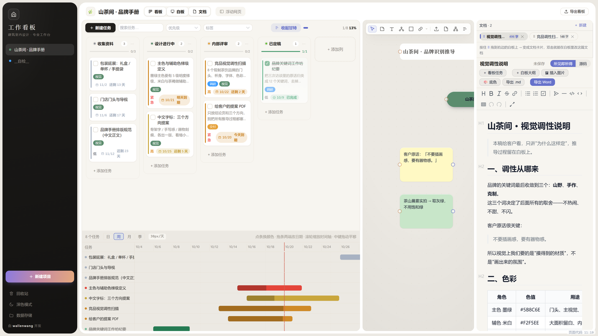
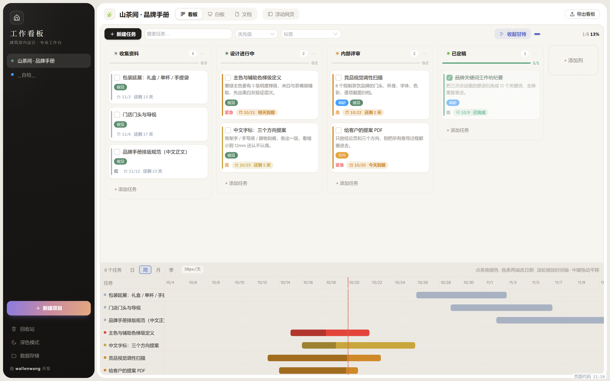
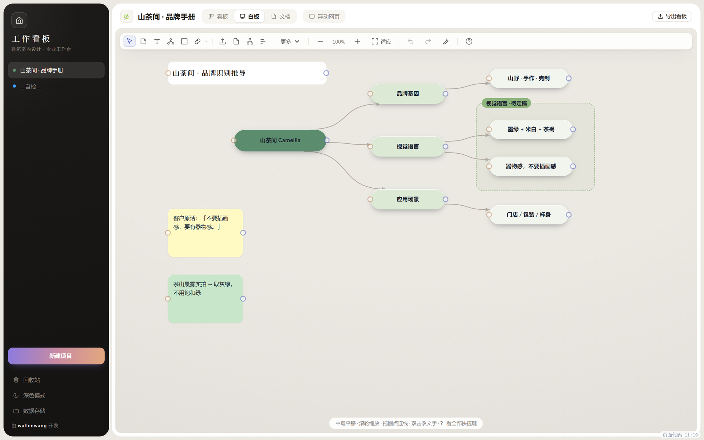
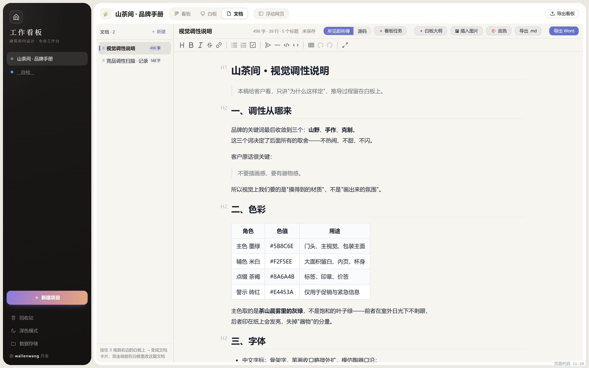
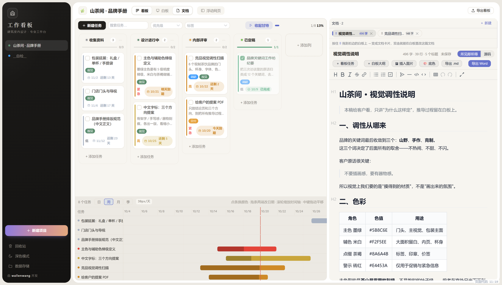

# 工作看板 · 功能图览

> 下面的截图全部是真实界面，演示项目叫「山茶间 · 品牌手册」。
> 只想先上手的话看 [使用指南](使用指南.md)；这篇用图讲清楚**每一块能干什么**。

---

## 一、一屏之内：看板 / 白板 / 文档



顶部三个开关（看板 / 白板 / 文档）**不是单选**：

| 点亮 | 结果 |
|---|---|
| 1 个 | 全屏这一栏 |
| 2 个 | 左右分屏 |
| 3 个 | 三栏并排 |

三条竖线都能拖动改宽度，双击均分。窗口窄到放不下时自动收成一栏，拉宽自动还原。

> 图里左边是任务卡，中间是白板推导，右边是正在写的品牌手册——
> 同一个项目的任务、脑图、成稿摆在一起，不用在软件之间来回切。

---

## 二、看板：任务和甘特是同一份数据



上半部是任务卡，下半部是一条常驻甘特图，**改动同步**：

- 卡片上的日期越近颜色越暖（黄 → 橙 → 红），逾期直接标红；
- 甘特条默认按紧迫度自动上色，点一下条子可以手动指定颜色（图里那条红色就是手动标的紧急项）；
- 滚轮缩放时间轴，中键拖动平移，拖条形两端改起止日期；
- 中间那条细缝上下拖，可以改甘特占的高度。

卡片右上角的勾选框完成之后，卡片变绿并自动排到列尾；删掉的任务进「回收站」，能恢复。

---

## 三、白板：便签、导图、分区，一套手势



白板不是画板，是**能随便摆的思考区**——节点类型有便签、文字、思维导图、分组框、图片、文档卡、甘特卡七种。

图上三件事值得注意：

1. **连线就是层级**。中心「山茶间 Camellia」往右连出三条，就是三个一级分支；再往下就是二级。所以这里的脑图和导图是同一个东西。
2. **分组框靠位置归属**，不需要把节点"拖进组"——节点中心落在框里就算这一区（图里那个绿色虚线框圈住了两条视觉语言）。拖框，整组跟着走。
3. **端口拖到空白处直接建节点**。从节点右边的小圆点拖出去松手，会弹出「便签 / 文字 / 导图 / 分组框 / 图片·资料 / 文档 / 甘特」菜单，选完自动连上。
   选「图片 / 资料」会先让你挑文件，选完直接建成图片节点并连回来。

便签的字色是自动的：浅底配深墨字，深底配白字，不用手调。

---

## 四、文档：像 Word 一样写，落成真 `.md`



- 左边是文档列表，右边所见即所得（不显示 `#`、`**` 这些符号）；
- 底色作用于**整个文档栏**（列表 + 标题 + 工具条 + 正文一体），默认护眼绿，也可以换纸白/米黄/淡蓝，字色自动跟着底色走；
- 插图有两种来源：本机选图、白板右键「发送到文档」；图片内嵌在 `.md` 里，单发文件给别人也不会裂图；
- 存下来是真实的 `.md` 文件，Typora、VS Code 直接能打开；
- 导出 Markdown（含图）或 Word（中文排版已调好，**暂无图片**）。

字数统计会自动排除图片数据，不会出现"30 万字"。

---

## 五、分屏：一边看任务，一边写正文



这是日常最常用的组合：左边盯着任务和截止日，右边直接写对应的正文。

想把白板上的导图变成大纲，点文档栏的「＋ 白板大纲」；想把看板任务贴成清单，点「＋ 看板任务」。

---

## 六、浮动网页：一个真浏览器，不是嵌网页

顶部「浮动网页」会开一个可拖动、可缩放的窗口，盖在任何栏上面查资料。

它是用系统内核的**独立网页视图**做的（不是 iframe），所以：

| 以前（v0.1.0） | 现在 |
|---|---|
| 豆包、Bing 结果页这类禁止被嵌入的站点会白屏 | 能正常打开 |
| 搜索结果点链接没反应 | 直接在当前浮动窗里跳转 |
| 登录状态记不住 | 能记住，可以一直挂着 |
| 中文域名被当成搜索词 | `豆包.com` 直接识别为网址 |

拖动时窗口跟手（每帧一次同步位置），关掉 20 秒后真正释放内存。软件**不预置任何第三方网站入口**，访问什么由你决定。

---

## 七、数据在哪

一个项目 = 一个文件夹：

```
%APPDATA%\com.kanban.desk\
├─ 项目列表.db                项目清单 + 偏好
└─ 山茶间 · 品牌手册/
   ├─ 看板与白板.db            任务、列、白板节点与连线
   ├─ 附件/                    上传的资料原件（保留原文件名）
   └─ 文档/                    文档正文，真 .md 文件
```

侧栏底部「数据存储」能看当前位置、打开文件夹、换个盘（会整体迁移，旧位置保留）。
**备份就整个目录一起拷**——只拷 `.db` 会丢附件和文档。

---

## 八、v0.1.0 → v0.4.0 做了什么

| 改动 | 说明 |
|---|---|
| 浮动网页换成子 webview | 禁止嵌入的站点也能开、链接原地跳转、登录态保留 |
| 拖动跟手 | 拖动/缩放时每帧一次到位，网页临时让位，框跑满 60fps |
| 中文域名识别 | `豆包.com`、`腾讯文档.中国` 直接当网址打开 |
| 白板端口菜单加「图片 / 资料」 | 拖出端口选它，挑完文件自动建节点并连线 |
| 文档栏底色统一 | 底色给整个文档栏（列表 + 工具条 + 正文），不再只染文字区 |
| 图标重绘 | 按作者 logo（房子轮廓 + 门洞拱形）重画，启动显式设置，不吃系统图标缓存 |
| 新增《使用指南》 | 装、拆、手势、快捷键、常见问题一份讲完 |

---

## 许可

[MIT](../LICENSE)。第三方组件许可见 [NOTICE.md](../NOTICE.md)。
