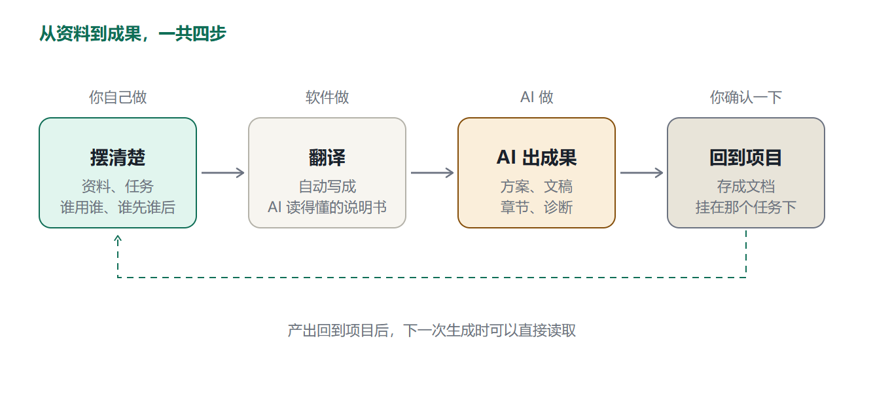
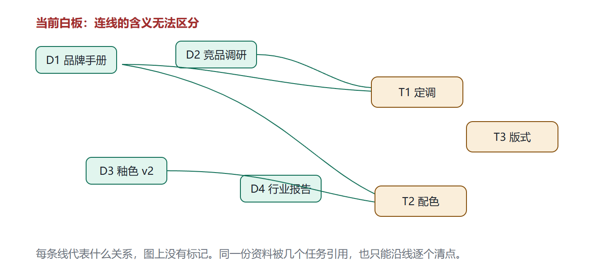
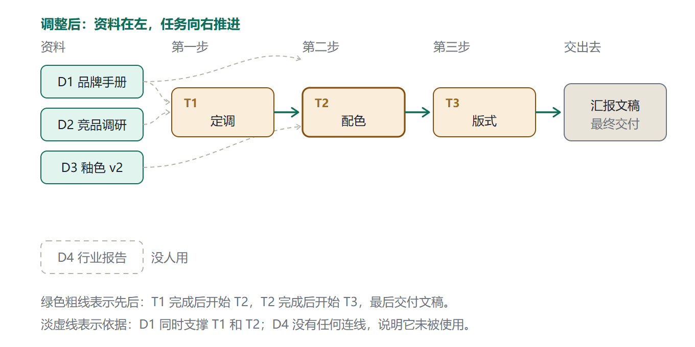
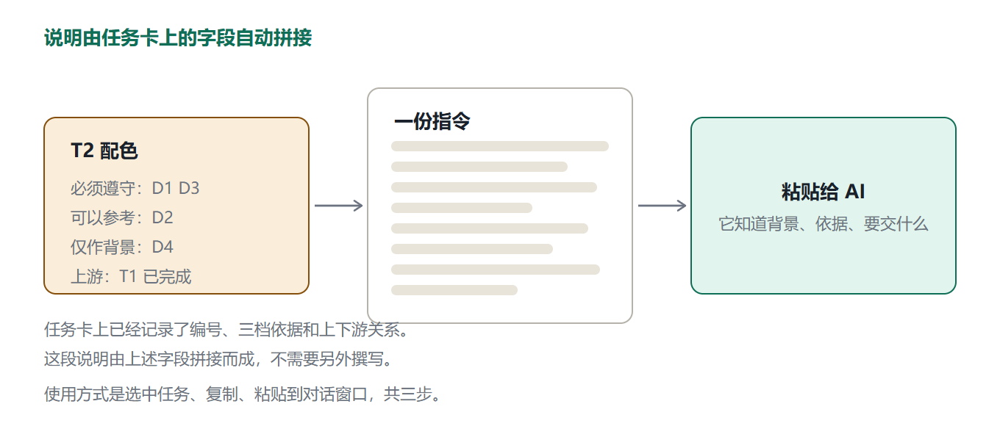
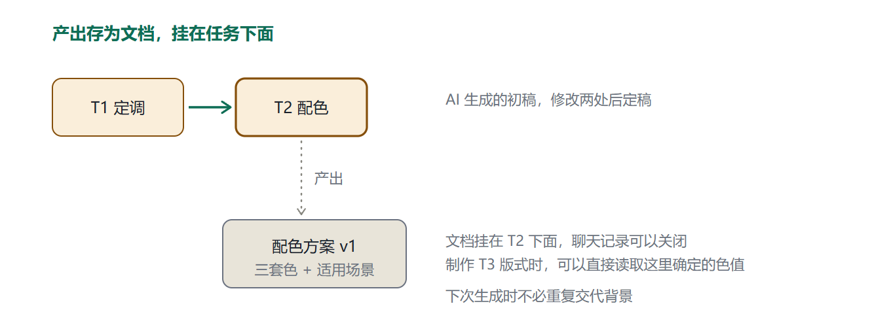
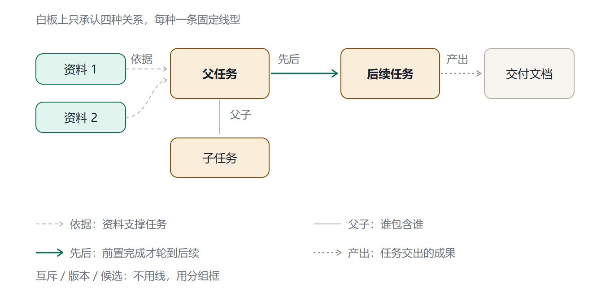
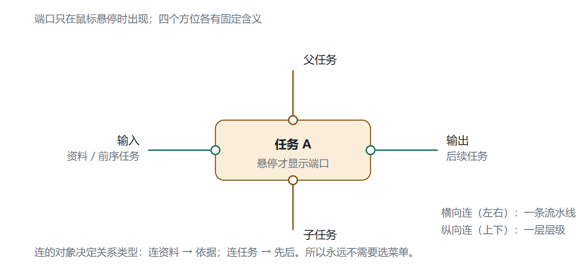
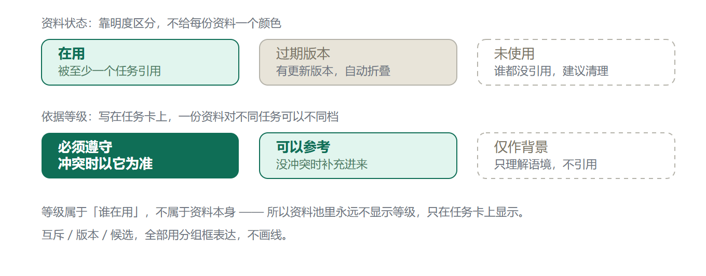
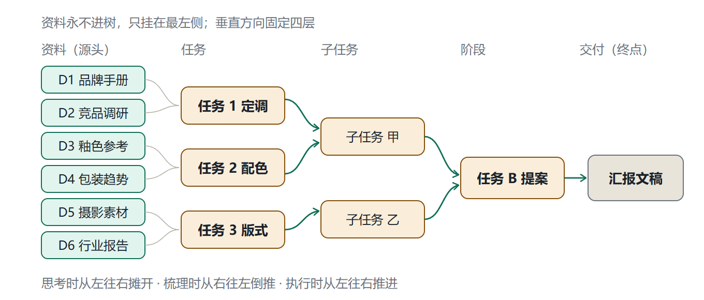
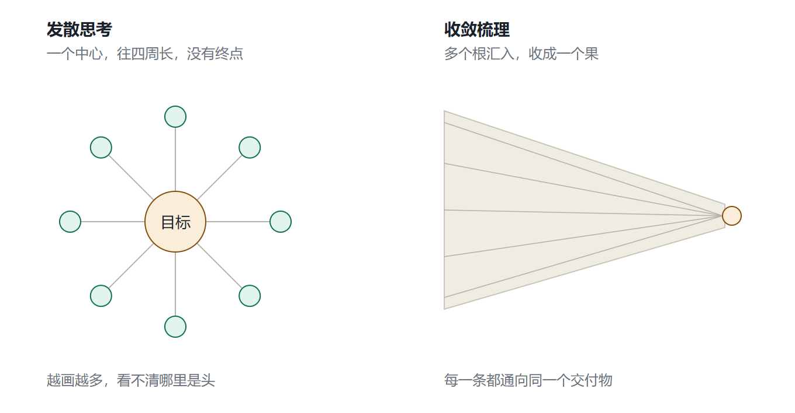

# 白板改造方案

## 一、要解决的问题

白板目前可以放置资料节点和任务节点，但节点之间的连线只有一种样式。用一条线连接两份资料和一个任务时，看不出这条线代表的是「这份资料支撑这个任务」，还是「这两个任务有先后顺序」。使用者本人靠记忆可以分辨，换一个人查看，或者交给 AI 处理，这些区别就消失了。

由此产生的直接后果是，每次请 AI 协助都要重新交代背景：资料存放在哪里，哪些是硬性约束，哪些任务必须等前一项完成。交代本身不复杂，但重复次数多了容易遗漏。遗漏了约束条件，生成的结果就不能直接用，需要反复修改。

这套改造处理的正是这个环节。

## 二、整体流程



流程分四步。第一步由使用者完成，把资料、任务和它们之间的关系在白板上确定下来。第二步由软件完成，把这些关系转写成一段结构化的文字说明。第三步把这段说明交给 AI，由它产出具体内容。第四步把产出存回项目，挂到对应的任务下面。

第四步完成之后，箭头回到第一步。这个循环的意义在于，产出的文档会保留在项目里，下次处理下游任务时，AI 可以读取上一次的结果，不必重新交代。项目做得越久，积累的上下文越多，后续生成时的准确度也会提高。

下面四节依次展开这四步，第七节说明为支撑这套流程，白板需要遵守的几条约定。

## 三、第一步：在白板上确定关系

### 3.1 现状



图中是四份资料和三个任务。乍看有结构，但这些线的含义无法区分：可能是资料归属，也可能是任务顺序。同一份资料被几个任务引用，也只能沿着线逐个清点。

这类信息如果不记录在数据结构里，就只能依靠使用者的记忆。记忆无法传递，也无法被程序读取。

### 3.2 调整后的形式



同一个项目调整后的形式。有三处变化：资料固定在左侧一列，任务按执行顺序向右排列，最后收在一个交付物上；连线按每段关系的含义区分开；未被引用的资料用虚线框标出，并注明没人使用。

这些变化的目的不是让画面整齐，而是把关系从「使用者的理解」转成「软件可读取的数据」。第二步的自动转写依赖这些数据，数据不完整，转写出来的说明就会缺项或者给出错误信息。

这一步需要手工完成，一个中等规模的项目大约需要十几分钟。它换来的是后续每次生成时省去背景说明。

## 四、第二步：转写成说明



选中一个任务后生成的内容如下。全部从库里读出来拼成，没有一句是预先写好的示例。

```
【任务 T2.1 · 版式与交付】
项目：山茶间 · 品牌手册
所属阶段 进行中　｜　交付截止 2026-11-02（剩余 11 天）

一、任务要求
按既定调性出 3 套版式：封面 + 内页 + 背标。
每套说明网格、字号层级、留白比例。

二、参考材料
下列 3 份资料随本指令一并提供，请直接查阅原文件。以下条目说明各份资料的约束层级与关注重点，不替代文件内容。
当资料之间、或资料与本指令发生冲突时，按约束层级高者执行。

【强制约束】不得违反；与本指令冲突时以资料为准　1 份
1. 品牌手册 v3（PDF，8.3 MB；分区「硬材料」· 强依据）
   关注重点：第 12 页的颜色规范最关键；主色限墨绿系，禁止高饱和红

【参考依据】可用于补充完善，不构成强制要求　1 份
1. 竞品调研（Excel，234 KB；分区「硬材料」· 强依据）

【背景资料】仅供理解语境，不得作为论据引用　1 份
1. 行业报告（PDF，12.0 MB）

说明：上述某份资料在白板分区中标为「强依据」，而在本任务中定级为「参考」。以本任务的定级为准。

三、任务关系
- 所属上级：T2 配色与版式
- 上游任务：T1 定调（已完成）
- 下游任务：T3 提案（待本任务完成后启动）

四、交付物
- 版式说明书
- 交付格式：Word 文档

五、输出要求
1. 结论先行：直接给出交付内容，不复述任务背景，结尾不询问是否继续
2. 「强制约束」不得违反；与本指令存在冲突时，以资料为准并明确指出
3. 「背景资料」仅供理解语境，不得作为论据引用
4. 资料之间表述不一致时，先说明冲突所在，不得自行取舍
5. 引用资料内容时注明出处
6. 「关注重点」仅用于定位，以原文为准；标注与原文不符时请指出
7. 输出完整可用的 Word 文档正文，不要输出提纲、占位符或待补充标记
8. 使用规范的标题层级（一级标题、二级标题），不要用 Markdown 井号

六、信息缺口
以下内容尚未确定，可能影响交付质量：
- 2 份资料未标注关注重点（竞品调研、行业报告）；文件虽可查阅，但篇幅较长，未标注易导致抓取错位
```

每一段对应库里的一个字段：任务说明取 `tasks.description`，约束层级取 `task_refs.level`，
关注重点取 `task_refs.point`，分区与强度取 `board_notes` 上那个框的 `meta.cluster`，
上下游取 `board_edges.kind`，交付格式取 `tasks.deliver_fmt`，产出物取 `produce` 边指向的节点。
所以任务改一个字、资料换个层级、关注重点改一句、格式换一个，重新点开就是新的内容。

三处容易漏、现在会自动处理的地方：

第一处是材料的移交方式。说明书里列的是清单，不是内容——软件在这几句话里带上的文件类型、大小、所属分区，AI 都用不上。所以清单开头会写明「下面这几个文件要一并传给我」，使用者照着把文件拖过去，AI 就能直接读原文件。这一点必须写出来，否则很容易以为光靠这几行字就够了。

关注重点写在「这份资料对当前任务」这条关系上，不写在资料本身。同一份品牌手册，挂在配色任务上是「主色限墨绿系」，挂在文案任务上可能是「语体不用感叹句」，两处可以不一样。

未标注关注重点的资料会在「信息缺口」中列出。这不是挑错，是让人知道这份说明书哪里还漏着。

第二处是「交付要求」。省略这一栏，回复通常先来一段客套话再给一堆铺垫，有效内容被推后。所以"直接给结论、不要复述、不要在结尾问我要不要继续"这几句是固定带的。

第三处是结尾关于冲突的说明。不写这一句，遇到两份资料矛盾时，AI 倾向于挑一种说法继续往下做，而不是提醒你这里有冲突。

第六段「信息缺口」是故意留的：任务说明空着、未关联资料、未指定交付格式、未标注关注重点，
软件知道，就直接告诉 AI，免得它在信息不全的情况下硬编。

### 为什么要按任务切分

把整个项目一次性交给 AI，它的处理能力不足以覆盖，实际行为是从中挑选若干段落阅读，其余部分依靠推测。按任务切分之后，信息量控制在一屏以内，而且全部与当前任务相关，生成质量明显更稳定。

### 两种输出形式

面向网页版对话工具时，说明中附一份图片清单，需要使用者手动上传。面向能够读取文件的 Agent 时，直接给出相对路径即可。复制时提供两个按钮区分这两种情况。

## 五、第三步：AI 产出内容

不同任务类型能产出的东西不同。方案类任务（配色、版式、命名）可以给出三到五套备选及适用场景，前提是硬约束已经写清，否则给出的方案可能整体不可用。文稿类任务（教材章节、汇报稿件）按照任务树的层级组织成文，前提是拆解结构完整、资料齐全。诊断类任务可以分析延期风险和积压情况，只需要日期和状态数据。

生成质量在很大程度上取决于第二步的材料标注写法。这一节没有额外的技术要点。

诊断类任务有一个附加用途：可以发现哪些任务没有任何资料支撑，以及哪些资料从未被引用。这两件事在白板上不容易看出来，因为未连线的节点在视觉上并不显眼。

## 六、第四步：产出存回项目



AI 生成的内容存为文档，通过「产出」这条连线挂在任务下面。对话窗口可以关闭，内容保留在项目里。

具体的好处是：制作 T3 版式时，AI 能够读取 T2 确定的色值，不需要重新粘贴；修改记录也保留着，它能区分初稿和定稿。

项目结束后，这些文件留在硬盘上。下次遇到同类项目，可以直接调出作为参考。

## 七、白板需要遵守的约定

以下五条约定的目的不是改善观感，而是保证第二步的自动转写能够取到完整信息。缺少任何一条，生成出来的说明都会缺项或者给出错误信息。

### 7.1 连线只有四种



四种关系的名称都用父集与子集来表达，因为看板上真正要看清的是「谁包含谁」：

| 关系 | 线的方向 | 含义 | 线的样子 |
|---|---|---|---|
| 父子 | 父集 → 子集 | 父集拆出子集，任务编号也按这条线计算 | 灰色细实线 |
| 先后 | 前置 → 后续 | 前置完成之后，后续才能开始 | 琥珀色加粗线 |
| 依据 | 材料 → 任务 | 材料是任务的依据，任务是使用它的那一方 | 绿色点线 |
| 产出 | 任务 → 成果 | 任务是父集，交出来的文档或成果是子集 | 紫色粗线，略微透明 |

区分这四种关系的原因很实际：AI 需要判断某份内容是「本次任务的输入材料」还是「必须先完成的前置工作」。两者混为一谈，它可能把上游任务的产出当作参考资料引用，也可能把参考性质的资料当作硬性前置条件。

绘制时不需要选择菜单，由拖动方向决定。



从资料节点拖向任务节点，生成依据关系；两个任务左右相连，生成先后关系；上下相连，生成父子关系。

代价是连线前需要判断一次关系类型。初期会稍慢，熟练之后比从菜单中选择更快。

### 7.2 互斥与版本用框表示

两份资料二选一时，把它们放进同一个「候选」框内。同一份资料存在多个版本时，归入「版本组」，旧版本自动置灰。

如果不做标注，AI 会把两份相互矛盾的资料同时作为依据，给出的建议自相矛盾。标注之后，它会先询问采用哪一份。

这里的分界线是：有方向的关系用线表示，无方向的归并用框表示。互斥、版本、同类归并都属于「若干对象属于同一类」的情形，本身没有方向，画成连线反而需要判断指向。

框上还可以标一件事：这一批材料有多硬。

| 档 | 含义 | 从框里拖资料到任务时，那条依据的默认档位 |
|---|---|---|
| 强依据 | 硬材料，结论有冲突时以它为准 | 必须遵守 |
| 参考 | 有启发但不强制（默认档） | 可以参考 |
| 弱参考 | 只用来了解语境，不要引用 | 仅作背景 |

三档跟任务卡上的三档一一对应，只是换了更好懂的词。不用「背景」这个词，因为它抽象；「弱参考」跟「强依据」对得上，一看就知道是弱的那头。

框上的强度说的是「这一堆东西整体有多硬」，任务卡上的等级说的是「这一份材料对这个任务是什么档」。前者定一个默认值，省掉每次拖线都要点一次改档；后者随时可以改，两者不冲突。

强度标签和分组名并排放在框的左上角：左边是名字，右边是强度。标签常显，不选中也能看见，因为它本身就是这个分区的信息。默认是「参考」，所以新框天生就有一个可点的标签，不需要先「标强度」。点一下换下一档，框的颜色也跟着换成该档的标准色。

分区的成员判定是**整张卡都在框内**才算。早先用的是「中心点在框内」，太松：卡片压住框边一点就被算进这一组，拖框时会连带把框外那张卡一起拖走。

### 7.3 依据分三档



三个等级分别是必须遵守、可以参考、仅作背景。AI 需要知道哪一份是硬性规范（违反即无效）、哪一份只是参考、哪一份只能用于了解背景而不能引用。三个等级足够，五档的话使用者自己也难以区分「较重要」和「一般」的界限。

有一点容易被误解：等级记录在「某任务使用了某资料」这个关系上，而不是记录在资料本身。同一份 D1，在定调任务中是必须遵守，在版式任务中可能只是参考。因此资料池不显示等级，等级只在任务卡上显示。

这里不做权重打分。分值难以自定，填写时缺乏依据，AI 拿到 0.7 这样的数字也不知道该如何处理。同一等级内部需要区分先后时，拖动调整顺序即可。

### 7.4 资料在左，任务向右，最终收口于交付物



资料不进入层级结构。资料数量没有上限，六份到六十份都有可能，纳入层级之后结构会迅速失去可读性。垂直方向固定四层，依次是交付物、阶段、任务、子任务。同一层不超过七个，超出则合并为分组。

节点的横向位置本身在表达进度，比在描述中写「进行中」更直观。

建议从右向左规划。从「手上有六份资料，需要做一份汇报」开始思考，容易陷入混乱，因为六份资料可以支撑多种做法，从起点无法判断终点。反向推导则每步只回答一个问题：要交付什么，它由哪几部分构成，每一部分需要什么前置工作，最后才落到资料上。走完一遍，多余的资料会自己暴露出来。

### 7.5 任务分配编号

编号形式为 T1、T2、T3，标在任务卡左上角。作用是让「处理 T2」这句话有明确的指向。

编号带层级：父任务是 T2，它的子任务就是 T2.1、T2.2，再往下是 T2.1.1。所以把 T3 拖到 T2 下面，它会自动变成 T2.1，不需要手动改名。

编号不存进数据库，每次按当前的父子关系算出来。这样做的好处是结构和编号永远一致；代价是结构一变，旧编号就失效了。跟 AI 交代时最好连任务名一起说（「T2.1 版式与交付」），只写编号的话，改动结构后就可能对不上。

同一层的先后按创建顺序排，所以拖动位置、换看板列都不会改变编号，只有父子关系变化才会变。

## 八、与思维导图的区别



思维导图是向外扩展的结构，从一个中心不断分叉，没有终点。项目结构是向内收敛的结构，一批材料最终归并为一份交付物。

两者形状相似，方向相反。你之前提到这是逆向的思维导图，这个理解基本准确：同一张图，正向阅读用于发散，反向阅读用于收敛。

AI 需要的是收敛这一面，因为它的任务是把交付物做出来，而不是参与发散过程。

## 九、附带的界面调整

| 项目 | 现状 | 调整后 |
|---|---|---|
| 节点两侧的连接点 | 始终显示 | 鼠标悬停时显示 |
| 点击连线 | 直接删除 | 选中后弹出菜单，删除放在最左侧 |
| 建分组框 | 先点按钮，再点一下画布 | 按住左键拖出一个范围；选中多张卡片后点同一个按钮就直接装进去（Ctrl+G 同效） |
| 分组框的语义 | 只是一块底色 | 名称右侧标约束强度（强依据 / 参考 / 弱参考），并决定拖线时的默认档位 |
| 布局混乱 | 手动重新排列 | 提供「理顺」按钮自动排序 |
| 画布模式 | 单一模式 | 增加开关，切换自由绘制与分列排列 |

---

# 附录：技术说明

## 数据库改动

现有字段不做修改，只增加新字段。这样老项目打开后的行为与当前版本一致。

```sql
ALTER TABLE tasks ADD COLUMN seq INTEGER NOT NULL DEFAULT 0;

ALTER TABLE board_notes ADD COLUMN role TEXT NOT NULL DEFAULT '';
-- role: '' | goal | input | constraint | work | output | defer
ALTER TABLE board_notes ADD COLUMN group_kind TEXT NOT NULL DEFAULT '';
-- group_kind: '' | candidates | versions

ALTER TABLE board_edges ADD COLUMN kind TEXT NOT NULL DEFAULT 'decompose';
-- kind: decompose | precede | evidence | produce
ALTER TABLE board_edges ADD COLUMN strength INTEGER NOT NULL DEFAULT 0;
```

依据关系涉及任务、白板节点和等级三个维度，单独建表：

```sql
CREATE TABLE IF NOT EXISTS task_refs (
  id         INTEGER PRIMARY KEY AUTOINCREMENT,
  project_id INTEGER NOT NULL REFERENCES projects(id) ON DELETE CASCADE,
  task_id    INTEGER NOT NULL REFERENCES tasks(id) ON DELETE CASCADE,
  note_id    INTEGER NOT NULL REFERENCES board_notes(id) ON DELETE CASCADE,
  level      INTEGER NOT NULL DEFAULT 1,   -- 0=必须 1=参考 2=背景
  ord        INTEGER NOT NULL DEFAULT 0,
  UNIQUE(task_id, note_id)
);
```

添加字段前需要使用 `PRAGMA table_info` 检查是否已存在。`seq` 为 0 表示尚未编号，启动时统一补充一次，该操作需要保证幂等。

不增加 `weight` 字段，不做版本分支，不做多个前置条件的「或」关系。

## 实施顺序

| 阶段 | 内容 | 主要风险 |
|---|---|---|
| P0 | 数据层（字段、task_refs、补编号）、端口悬停显示、连线菜单、依据分档界面 | 老库执行 ALTER 需要守卫；任务卡变高会影响导出布局 |
| P1 | 自动生成说明（aiPrompt.ts）、理顺按钮、双模式、资料状态着色、超量折叠 | 理顺遇到循环依赖需要报错，不能进入死循环 |
| P2 | 导出文件夹（AGENTS.md 与实体图片）、冲突检测、上下游追溯 | 图片需要从 base64 转为实体文件 |

每项完成后执行 `cargo check` 和 `cargo test`，同步更新 `mock.ts`，白板导出功能跟随调整。

## 导出目录结构

```
项目名/
├── AGENTS.md            阅读说明，Agent 进入目录后先读此文件
├── 01-项目概览.md
├── 02-任务结构.md
├── 03-任务全量.md
├── 04-白板结构.md        按分组用途组织，包含任务树和先后链
├── 05-资料清单.md
├── 06-文档/<标题>.md
├── 07-关系.json
├── manifest.json
└── assets/
```

`AGENTS.md` 中需要写明项目性质、阅读顺序、四种连线各自的含义、三个等级的含义，以及不要一次性读取全部文档。

---

*2026-10-22*
